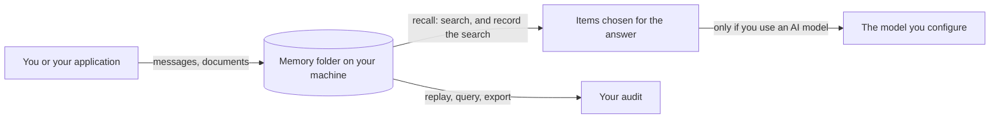

# Privacy and data flow

Where your data goes, and how to use the library without surprises. This page is not legal advice.

## The flow

In words:

1. You write messages and documents. They are stored in one folder, on the machine that runs the
   library.
2. A recall searches that memory, records which items it chose, and returns them.
3. The library sends nothing anywhere. If you use the optional assistant, your question and the
   chosen items are sent to the model service you configure. By default that is OpenRouter, a cloud
   service.
4. Audits read the same folder.

## What is stored

| Data | Where | Removed by |
|---|---|---|
| Messages and documents, in plain text | The memory folder | Deleting the folder. `delete()` hides an item but keeps it |
| The record of every recall, with its search text | The memory folder | Deleting the folder |
| Deletions, with reason and who asked | The memory folder | Deleting the folder |
| The model service key | An environment variable. It is never written to the memory | |

A search text, a deletion reason, and a name in `requested_by` are stored too. Do not put personal
details in them that you would not want to keep.

## Safe and unsafe use

| Safe | Unsafe |
|---|---|
| Made-up or anonymised data while trying things out | Real personal data in a trial |
| A memory folder only your service account can read, on an encrypted disk | A shared or synchronised folder anyone can open |
| A model on your own machine when text must not leave it | The default cloud model with confidential text |
| `retain_until` on entries, and `expire()` on a schedule | Keeping everything because nobody set a rule |
| A reference to sensitive data, with the data kept where it can be erased | Sensitive data written into the log, when you may have to erase it |
| One writing process per memory | Several processes writing the same folder |

## Collect less

- Store the part you need, not the whole document.
- Use roles ("resident-a") instead of names where the name adds nothing.
- Give each entry a keep time when you write it.
- Write deletion reasons that say why without repeating the removed detail.

## Personal data

If you process personal data, you are responsible for having a lawful basis, for telling people
what you keep, and for answering their requests. Because this library does not erase single entries,
decide before you start how you would meet an erasure request. If your use is likely to carry a high
risk for people, the GDPR asks for a data protection impact assessment first. Ask your privacy
officer. The [templates](templates.md) help you write down sources, keep times, and requests.
